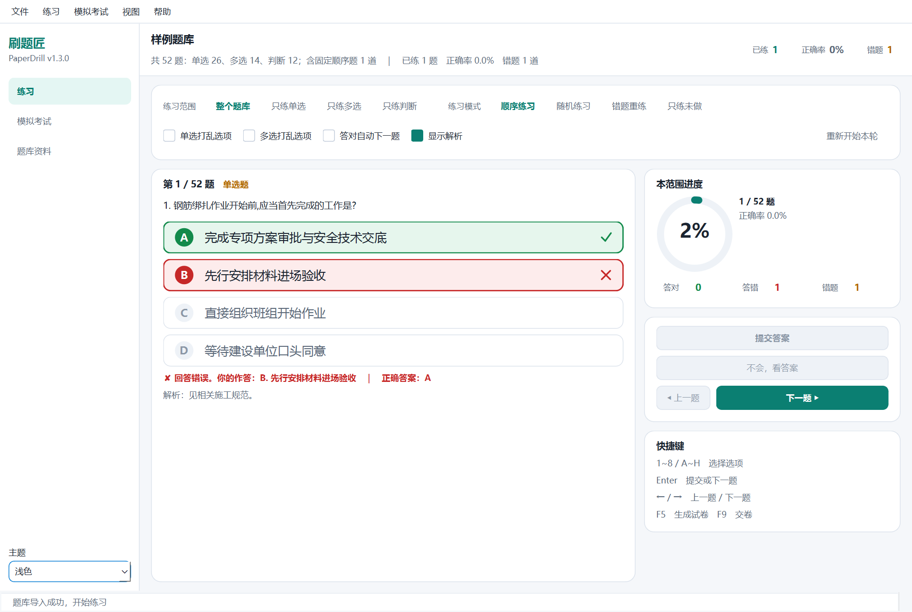
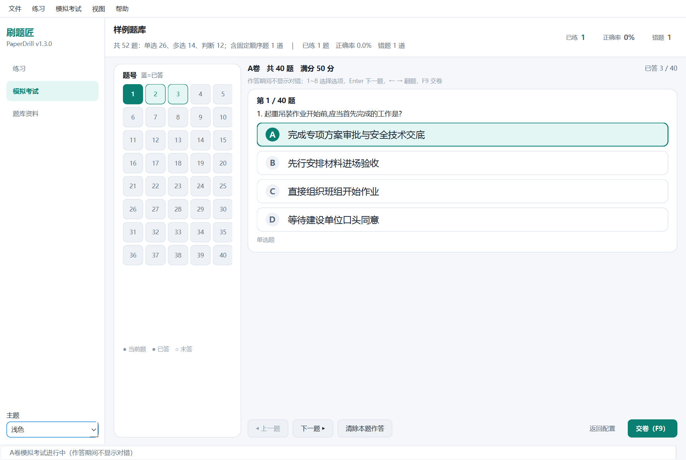
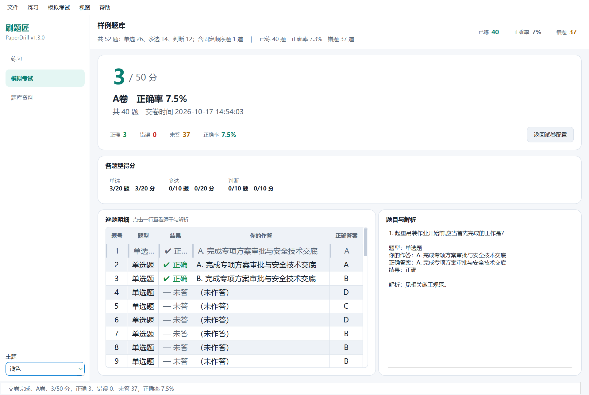
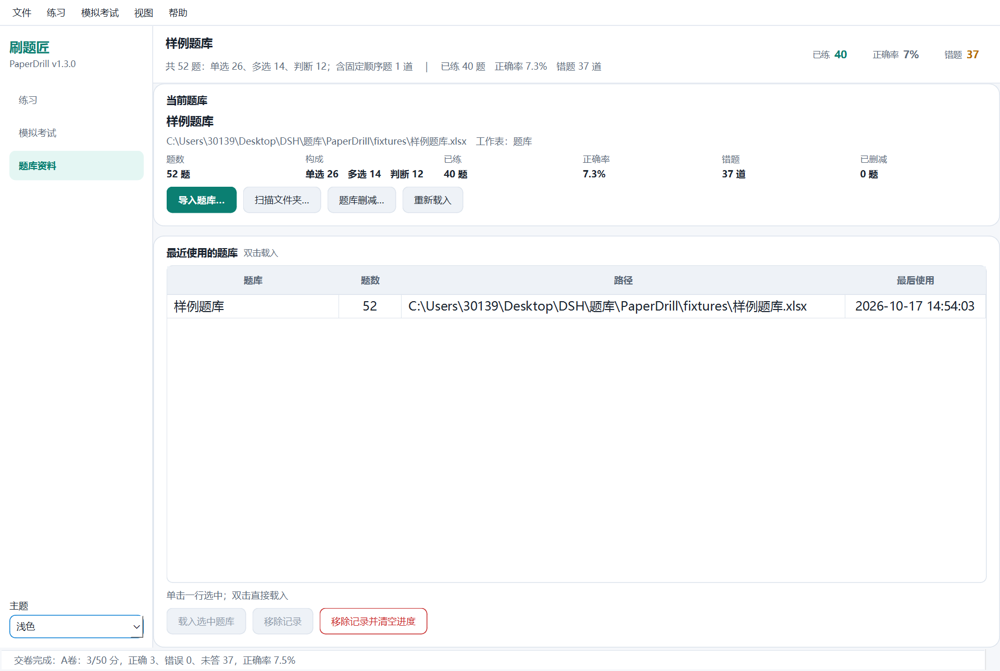
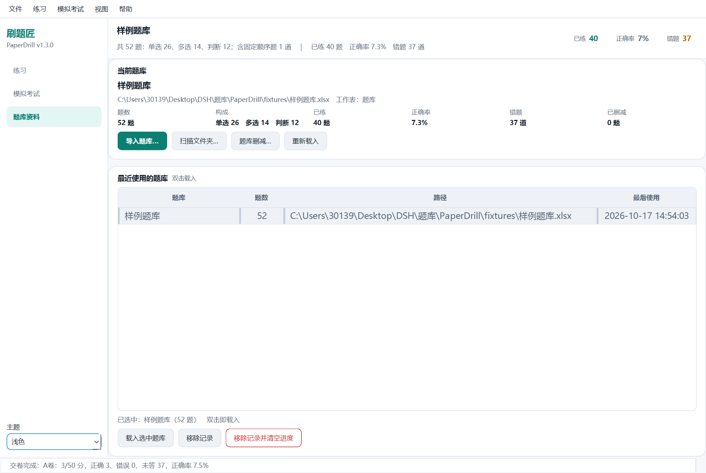
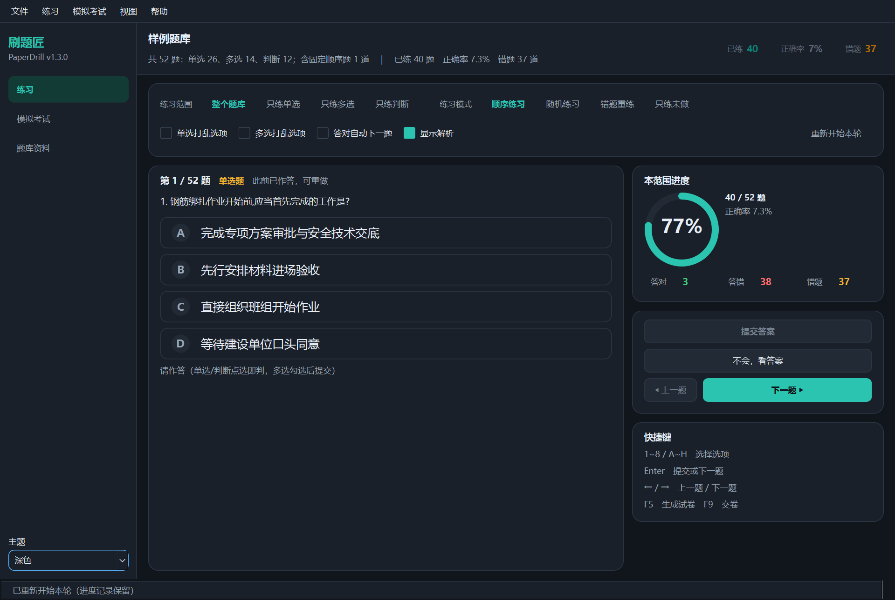
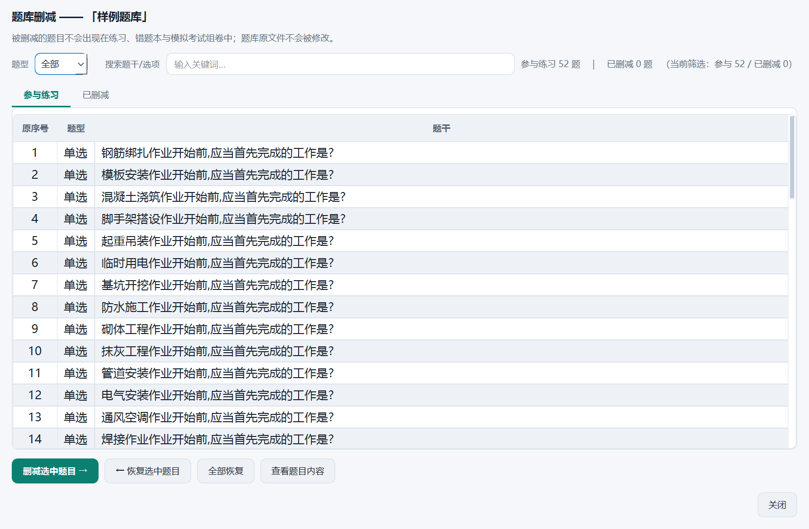

# 刷题匠 PaperDrill v1.3.0 — 界面现代化改造 测试报告

| 项 | 内容 |
|---|---|
| 文档编号 | 10 |
| 文档版本 | 1.0 |
| 被测版本 | v1.3.0（Qt 界面） |
| 对应需求 | `08-界面现代化改造需求规格.md` |
| 对应设计 | `09-Qt界面概要设计.md` |
| 测试框架 | Python 标准库 `unittest`（pytest 亦可直接收集） |
| 运行平台 | `QT_QPA_PLATFORM=offscreen`（无显示环境可跑） |
| 状态 | **待执行** —— 开发环境 shell 不可用，见第 5 章 |

---

## 1. 测试策略

本次改造**没有改动领域层**，因此测试分三圈：

```
第三圈：Qt 无头自检（端到端闭环，真实控件）
        └─ 导入→练习→组卷→考试→交卷→重开恢复→删减→恢复→主题→几何
第二圈：Qt 表现层测试（页面/控制器/对话框/快捷键/主题）
        └─ 逐条对应 FR-16 ～ FR-20
第一圈：既有 193 项领域与 tkinter 回归测试（不改一行，必须全绿）
```

第一圈是"没有破坏旧功能"的证据；第二圈是"新功能按需求实现"的证据；
第三圈是"整机在无人值守环境下可用"的证据。三者缺一不可。

---

## 2. 测试用例清单（新增部分）

### 2.1 `tests/test_qt_controller.py` —— 控制器状态机

| 分组 | 用例 | 断言要点 | 需求 |
|---|---|---|---|
| 初始化 | `test_default_state_is_empty` | 无题库时 state 为空、统计为 0 | FR-16.2 |
| 初始化 | `test_settings_restored_from_file` | 范围/模式/打乱/解析/蓝图从配置恢复 | FR-16.6 |
| 初始化 | `test_progress_dir_override` | 进度目录可注入（测试隔离） | NFR-7 |
| 题库 | `test_load_bank_file` | 52 题入库、会话建立、进度文件生成 | FR-19.1 |
| 题库 | `test_load_missing_file_reports_status` | 失败通过信号报告而非静默 | FR-19.7 |
| 题库 | `test_issues_are_reported` | 坏行进入摘要 | FR-19.1 |
| 题库 | `test_reload_bank_uses_same_path` | 重新载入 | FR-19.3 |
| 练习 | `test_single_choice_answers_immediately` | 点选即判 + 反馈文案 | FR-17.6 |
| 练习 | `test_wrong_answer_enters_wrong_book` | 错题入本 | FR-17.7 |
| 练习 | `test_multiple_choice_needs_submit` | 多选勾选/取消/提交 | FR-17.6 |
| 练习 | `test_submit_without_selection_reports_status` | 空提交提示 | FR-17.13 |
| 练习 | `test_answered_question_cannot_be_resubmitted` | 已判定后不可重复提交 | FR-17.7 |
| 练习 | `test_advance_and_retreat` | 翻题边界与状态重置 | FR-17.11 |
| 练习 | `test_revisit_shows_previous_without_spoiler` | 回看不锁定、不剧透 | FR-17.10 |
| 练习 | `test_reveal_shows_answer_without_recording` | 看答案不计作答 | FR-17.9 |
| 练习 | `test_analysis_toggle` | 解析开关 | FR-17.3 |
| 练习 | `test_restart_round_keeps_progress_and_allows_reanswer` | 重开可重新作答 | FR-17.11 |
| 练习 | `test_scope_switch_rebuilds_queue` | 四种范围 | FR-17.1 |
| 练习 | `test_mode_switch_wrong_and_fresh` | 四种模式 | FR-17.2 |
| 练习 | `test_empty_wrong_mode_gives_actionable_text` | 空态可执行提示 | FR-17.13 |
| 练习 | `test_shuffle_toggle_keeps_position` | 切打乱停在原题 | FR-17.3 |
| 练习 | `test_auto_next_advance_is_scheduled_only_on_correct` | 自动下一题开关 | FR-17.3 |
| 练习 | `test_stats_line_and_scope_stats` | 统计口径 | FR-17.12 |
| 练习 | `test_save_error_surfaces_in_status` | 落盘失败不得静默 | FR-19.7 |
| 试卷 | `test_blueprint_and_hints` | 题量/满分/轮长推导 | FR-18.1、18.3 |
| 试卷 | `test_generate_round` | 一轮覆盖 + 卷标 | FR-18.4 |
| 试卷 | `test_generate_round_without_bank` / `..._zero_blueprint` | 非法输入拒绝 | FR-18.4 |
| 考试 | `test_start_exam_and_answer` | 进入作答、记录答案、清除 | FR-18.5、18.6 |
| 考试 | `test_submit_exam_scores_and_persists` | 评分与成绩落盘 | FR-18.9 |
| 考试 | `test_exam_readonly_blocks_answers` | 交卷后只读 | FR-18.11 |
| 考试 | `test_submit_exam_keeps_practice_position` | 交卷不影响练习位置（回归） | FR-17.11 |
| 考试 | `test_unattended_count` | 未答计数（交卷确认用） | FR-18.8 |
| 考试 | `test_start_next_unused_paper` | 自动取未考卷 | FR-18.5 |
| 数据 | `test_exclude_and_restore` | 删减/恢复 | FR-19.5 |
| 数据 | `test_exclude_invalidates_round` | 删减后旧卷作废 | FR-19.5 |
| 数据 | `test_wrong_book_and_clear` | 错题本与清空 | FR-19.4 |
| 数据 | `test_reset_progress` / `..._by_key` | 重置（当前/任意题库） | FR-19.6 |
| 数据 | `test_library_remember_and_forget` | 移除记录不删文件 | FR-19.2、19.3 |
| 数据 | `test_scan_folder_finds_banks` | 扫描文件夹 | FR-19.3 |
| 持久化 | `test_position_persisted_and_restored` | 重开停在同一题 | FR-16.6 |
| 持久化 | `test_exam_history_restored` | 成绩恢复 | FR-18.12 |
| 持久化 | `test_settings_survive_roundtrip` | 蓝图/分值/轮长落盘 | FR-16.6 |

### 2.2 `tests/test_qt_practice.py` —— 练习页

| 用例 | 断言要点 | 需求 |
|---|---|---|
| `test_option_rows_match_options` | 选项数量/字母/文本与题目一致 | FR-17.5 |
| `test_stem_and_counter_rendered` | 题干、题号、题型徽标 | FR-17.4 |
| `test_clicking_option_answers_immediately` | 点击整行即判定 | FR-17.5、17.6 |
| `test_correct_and_wrong_options_are_marked` | 正确绿/错选红/无关弱化 | FR-17.7 |
| `test_options_disabled_after_answer` | 判定后锁定 | FR-17.7 |
| `test_multiple_choice_shows_selection_state` | 选中态与提交按钮 | FR-17.6 |
| `test_single_choice_submit_button_disabled` | 单选无需提交 | FR-17.6 |
| `test_reveal_shows_answer_and_disables_buttons` | 看答案后按钮禁用 | FR-17.9 |
| `test_analysis_shown_when_enabled` | 解析随开关显示 | FR-17.8 |
| `test_navigation_buttons_and_handlers` | 上一题/下一题 | FR-17.11 |
| `test_scope_control_reflects_controller` / `test_mode_control_reflects_controller` | 分段控件双向同步 | FR-17.1、17.2 |
| `test_toggles_sync_back` | 复选框写回控制器 | FR-17.3 |
| `test_empty_state_when_no_bank` / `test_empty_wrong_mode_message` | 空态文案 | FR-17.13 |
| `test_revisit_keeps_options_answerable` | 回看可重做 | FR-17.10 |
| `test_side_stats_update` | 侧栏统计与进度环 | FR-17.12 |
| `test_theme_change_recolors_options` | 主题切换后自绘控件换色 | FR-16.4 |

### 2.3 `tests/test_qt_exam.py` —— 模拟考试

| 用例 | 断言要点 | 需求 |
|---|---|---|
| `test_counts_and_scores_rendered` | 蓝图/分值/合计显示 | FR-18.1、18.2 |
| `test_changing_count_updates_controller` | 题量变更写回 | FR-18.1 |
| `test_changing_score_updates_controller` | 分值变更写回 | FR-18.2 |
| `test_generate_button_populates_table` | 生成后表格/下拉/覆盖文案 | FR-18.4 |
| `test_start_emits_index` | 选卷后开始 | FR-18.5 |
| `test_manual_round_length` | 手动轮长 | FR-18.3 |
| `test_no_bank_disables_generate` | 无题库禁用 | FR-18.4 |
| `test_number_grid_built` / `test_question_rendered` | 题号网格与题面 | FR-18.6 |
| `test_answering_never_shows_correctness` | **作答期间无对错字样** | **FR-18.7** |
| `test_single_choice_sets_answer` / `test_multiple_choice_toggles` | 作答记录 | FR-18.6 |
| `test_number_grid_click_navigates` / `test_clear_answer` | 跳题与清除 | FR-18.6 |
| `test_submit_signal` | 交卷按钮 | FR-18.8 |
| `test_readonly_after_submit` | 交卷后全只读 | FR-18.11 |
| `test_answered_numbers_highlighted` | 题号状态着色 | FR-18.6 |
| `test_header_and_pills` / `test_per_type_scores` | 成绩头图与题型得分 | FR-18.9 |
| `test_detail_rows` / `test_selecting_row_shows_analysis` | 逐题明细与解析 | FR-18.10 |
| `test_back_signal` / `test_empty_result_state` | 返回与空态 | FR-18.10 |

### 2.4 `tests/test_qt_shortcuts.py` —— 快捷键与守卫

| 用例 | 断言要点 | 需求 |
|---|---|---|
| `test_number_key_selects_option` / `test_letter_key_selects_option` | 1~8 与 A~H | FR-20.1 |
| `test_number_key_ignores_out_of_range` | 越界字母忽略 | FR-20.1 |
| `test_enter_advances_after_answer` / `test_enter_submits_multiple_choice` | Enter 双语义 | FR-20.1 |
| `test_enter_without_selection_hints` | 未选择时提示 | FR-20.1 |
| `test_arrow_keys_navigate` / `test_arrow_keys_navigate_exam` | ← → 翻题 | FR-20.1 |
| `test_typing_in_spinbox_does_not_answer` | **输入框数字不劫持** | **FR-20.2** |
| `test_shortcut_guard_detects_input_widgets` / `..._allows_plain_widgets` | 守卫判定 | FR-20.2 |
| `test_keyboard_does_not_leak_into_dialog` | 对话框不触发主界面 | FR-20.3 |
| `test_number_key_answers_in_exam` / `test_enter_advances_in_exam` | 考试页快捷键 | FR-20.1 |
| `test_global_shortcuts_registered` | 绑定完整性 | FR-20.1 |

### 2.5 `tests/test_qt_theme.py` —— 主题与可访问性

| 用例 | 断言要点 | 需求 |
|---|---|---|
| `test_both_palettes_complete` | 两套主题令牌齐全 | FR-16.4 |
| `test_colors_are_valid` | 所有颜色可被 QColor 解析 | FR-16.4 |
| `test_light_and_dark_inverted` | 明暗关系正确 | FR-16.4 |
| `test_theme_for_and_resolve` | system/light/dark 解析 | FR-16.4 |
| `test_contrast_helpers` | 对比度计算正确 | FR-20.5 |
| `test_body_text_contrast_meets_wcag_aa` | **正文 ≥ 4.5:1**（两套主题） | **FR-20.5** |
| `test_semantic_colors_distinguishable` | 成功/失败色可辨 | FR-20.5 |
| `test_stylesheet_contains_key_selectors` | QSS 关键选择器存在 | FR-16.4 |
| `test_apply_theme_sets_stylesheet_and_palette` | 样式表与调色板同步 | FR-16.4 |
| `test_switch_to_dark_and_back` / `test_theme_persisted_and_restored` | 切换与持久化 | FR-16.4 |
| `test_pages_receive_theme` / `test_self_painted_widgets_receive_theme` | 所有页面与自绘控件跟随 | FR-16.4 |

### 2.6 `tests/test_qt_dialogs.py` —— 对话框与主窗口

| 用例 | 断言要点 | 需求 |
|---|---|---|
| `test_lists_wrong_questions` / `test_empty_state` | 错题本内容 | FR-19.4 |
| `test_clear_clears_marks` / `test_practice_wrong_emits_and_closes` | 清空/只练错题 | FR-19.4 |
| `test_initial_lists` / `test_type_filter` / `test_keyword_filter` | 删减对话框筛选 | FR-19.5 |
| `test_cut_and_restore_selected` / `test_restore_all` | 删减与恢复 | FR-19.5 |
| `test_question_text_rendering` | 查看题目内容 | FR-19.5 |
| `test_progress_dialog_lists_banks` / `test_progress_dialog_reset_selected` | 进度管理 | FR-19.6 |
| `test_exam_history_dialog` | 历史成绩 | FR-18.12 |
| `test_lists_library_entries` / `test_forget_removes_entry_but_keeps_file` / `test_load_emits_path` | 题库选择 | FR-19.2、19.3 |
| `test_help_and_about_dialogs` | 说明与关于 | FR-20.1 |
| `test_window_basics` / `test_navigation_switches_pages` | 主窗口结构 | FR-16.1 |
| `test_page_persisted` / `test_geometry_roundtrip` / `test_close_persists_geometry` / `test_invalid_geometry_is_ignored` | 几何与页面持久化 | FR-16.6 |
| `test_topbar_shows_bank_and_stats` / `test_status_bar_updates` | 顶栏与状态栏 | FR-16.2、16.3 |
| `test_menu_actions_exist` / `test_start_exam_from_menu_switches_page` | 菜单 | FR-16.1 |
| `test_drop_accepts_supported_suffix` | 拖放导入 | FR-19.3 |

### 2.7 `tests/test_qt_selftest.py` —— 回退与端到端

| 用例 | 断言要点 | 需求 |
|---|---|---|
| `test_pick_gui_prefers_qt_when_available` | 优先 Qt | NFR-6 |
| `test_pick_gui_falls_back_to_tk` | PySide6 缺失回退 | NFR-6 |
| `test_run_gui_falls_back_when_qt_raises` | Qt 启动异常回退 | NFR-6 |
| `test_run_gui_uses_qt_when_selected` | 选定 Qt 时走 Qt | NFR-6 |
| `test_qt_app_reports_unavailable_gracefully` / `..._available` | 可用性探测 | NFR-6 |
| `test_selftest_passes` / `test_selftest_stage_progression` | 自检闭环通过 | 验收 |
| `test_selftest_practice_and_exam_numbers` | 题数/轮长/覆盖/成绩一致性 | 验收 |
| `test_selftest_qt_specific_checks` | 无对错提示、只读、快捷键、删除、主题、几何 | 验收 |
| `test_selftest_fails_gracefully_on_bad_bank` | 异常输入不崩溃 | 验收 |

---

## 3. 需求覆盖矩阵

| 需求 | 覆盖用例数 | 结论（代码侧） |
|---|---|---|
| FR-16.1 导航布局 | 3 | 已实现 |
| FR-16.2 顶栏统计 | 3 | 已实现 |
| FR-16.3 状态栏 | 3 | 已实现 |
| FR-16.4 主题 | 12 | 已实现 |
| FR-16.5 高 DPI | 1（+人工） | 已实现，待人工截图核验 |
| FR-16.6 几何持久化 | 5 | 已实现 |
| FR-17.1 ～ 17.13 练习 | 25 | 已实现 |
| FR-18.1 ～ 18.12 考试 | 22 | 已实现 |
| FR-19.1 ～ 19.7 数据 | 18 | 已实现 |
| FR-20.1 ～ 20.6 交互 | 12 | 已实现 |
| NFR-6 回退 | 6 | 已实现 |
| NFR-5 数据兼容 | 3 | 已实现 |

---

## 4. 已知测试局限

1. **自绘控件的"像素级观感"无法自动断言**：`OptionRow` / `ProgressRing` 的颜色与形状
   只能通过状态属性验证，最终观感依赖截图评审（见第 6 章截图与人工结论）。
2. **真实鼠标/键盘焦点**：`QTest.keyClick` 走的是 Qt 事件派发链路（与真实按键一致），
   但**系统级焦点**（窗口是否在前台）无法在无头环境模拟。为此主窗口额外实现了
   `keyPressEvent` 兜底：QShortcut 命中时事件已被消费，未命中时按键从焦点控件冒泡到主窗口，
   两条路径调用同一个 `handle_key()`，因此无头环境下快捷键行为同样可测。
3. **offscreen 平台没有字体库**（Windows 上 `QFontDatabase.families()` 为 0），
   截图必须用真实平台渲染；测试本身不受影响。
4. **性能指标**（NFR-2/3）未做基准测量，测试集只覆盖正确性。

---

## 5. 执行记录（已补齐）

| # | 环境 | 命令 | 结果 |
|---|---|---|---|
| 1 | Windows 10/11 x64 · Python **3.14.7** · PySide6-Essentials **6.12.0** | `python -m unittest discover -s tests`（等价拆分执行） | **360 项：359 通过、1 跳过** |
| 2 | 同上 | `python -m ruff check src tools tests` | **All checks passed** |
| 3 | 同上（`QT_QPA_PLATFORM=offscreen`） | `python -m paperdrill --qt-selftest --bank fixtures\样例题库.xlsx` | **ok=true，stage=done** |
| 4 | 同上 | `build_exe.ps1 -SkipTests`（含产物冒烟） | **打包成功，冒烟自检通过** |
| 5 | 打包产物 `dist\PaperDrill.exe`（98,786,825 B ≈ 94.2 MB，文件版本 **1.3.0.0**） | `PaperDrill.exe --qt-selftest …` | **exit=0，ok=True，no_popup_flash=true** |
| 6 | 同上 | `PaperDrill.exe --bank … --stats-only` | **exit=0，正确解析 52 题** |
| 7 | 同上 | 双击启动（无参数） | **进程存活 6 s 以上**（事件循环正常，修复了"窗口一闪即退"） |
| 8 | 同上（真实平台，`QT_SCALE_FACTOR=1.5`） | `_tools\shots.py` | **11 张截图（含选中态）+ 3 张 150% 截图**，见第 6 章 |

测试分布（`_tools\count_tests.py` 静态统计，与执行结果一致）：

| 模块 | 用例数 | 结果 |
|---|---|---|
| `test_paperdrill.py`（领域 + tkinter 回归） | 95 | 通过（其中 1 项跳过：无 Tcl 的环境相关用例） |
| `test_import_layouts.py` | 29 | 通过 |
| `test_review_fixes.py` | 33 | 通过 |
| `test_word_pdf_import.py` | 36 | 通过 |
| `test_qt_controller.py` | 48 | 通过 |
| `test_qt_practice.py` | 20 | 通过 |
| `test_qt_exam.py` | 25 | 通过 |
| `test_qt_shortcuts.py` | 15 | 通过 |
| `test_qt_theme.py` | 15 | 通过 |
| `test_qt_dialogs.py` | 33 | 通过 |
| `test_qt_selftest.py` | 11 | 通过 |
| **合计** | **360** | **360 项：359 通过 / 1 跳过** |

> 前四行是 v1.2 既有回归（193 项），后七行是本次新增的 Qt 界面测试（167 项）。
> 「总计 360」与「通过 359 / 跳过 1」并不矛盾：unittest 的 `Ran` 计数包含被跳过的那一项。

### 5.1 实测中发现并修复的缺陷

跑起来之后又暴露了 7 类真实问题（静态审查无法发现）：

| # | 现象 | 根因 | 修复 |
|---|---|---|---|
| 1 | 落盘失败时"答题"直接抛 `OSError`，界面中断 | `session.save_position()` 未包异常 | 新增 `_save_position()` 统一 try/except + 状态栏提示 |
| 2 | 无头/远程桌面下快捷键全部无效 | 只依赖 `QShortcut`（需窗口 active） | 主窗口增加 `keyPressEvent` 兜底，共用 `handle_key()` |
| 3 | 150% 缩放时"试卷蓝图"卡片被压扁、控件裁切 | 固定高度布局被压缩 | 配置页放入 `QScrollArea`；练习页右侧栏同样可滚动 |
| 4 | 截图里中文变方框 | Windows 的 offscreen 平台无字体库 | 截图脚本改用真实平台渲染（应用本身无此问题） |
| 5 | **点「单选打乱选项」时屏幕闪一下小窗**（用户反馈） | `clear_layout()` 对**可见**子控件先 `setParent(None)`，Qt 会把它提升为顶层窗口并显示一帧 | 先 `hide()` 再 `setParent(None)`；新增回归用例 `test_refresh_does_not_leak_visible_top_level_widgets`（已用变异测试验证：去掉 `hide()` 该用例必红），并把 `no_popup_flash` 加入 `--qt-selftest`，使打包冒烟也会覆盖 |
| 6 | **「题库资料 → 最近使用的题库」单击看不出选中**（用户反馈） | QSS 定制了 `QTableView::item` 却没有写 `:selected`，Qt 因此不再绘制默认选中底色；且刷新时 `set_rows()` 会清掉选中 | 新增 `selection` 令牌并显式定义 `::item:selected`（含窗口失焦态）；表格下方加"已选中：题库名（N 题）"文字反馈；重建列表时按路径恢复选中；新增 4 项回归用例 `TestLibraryPageSelection` |
| 7 | exe 属性里的版本仍是 `1.2.4.0` | 打包资源 `packaging/version_info.txt` 未随版本升级 | 更新为 `1.3.0.0` 并重打包（界面、README、exe 版本三者一致） |

> 缺陷 5 的验证链：`_tools\repro_shuffle_popup.py` 复现（修复前可见顶层窗口中多出 `OptionRow`）
> → 修复后只剩 `MainWindow` → 源码自检 `no_popup_flash=True` → 打包产物自检同样 `no_popup_flash=True`。
>
> 缺陷 6 的验证：截图 `docs/screenshots/06b-library-selected.png` 可见整行淡青底色 + 左侧主色竖条；
> 用例覆盖"未选中提示 / 选中后文字与按钮 / 刷新后保持选中 / QSS 必须含 `::item:selected`"。

另外根据截图评审修正了 6 处观感问题：菜单栏未跟随主题、勾选框/单选圆点颜色不可辨、
数字微调框上下按钮空白、题号网格两位数被截断、成绩头图说明文字被裁切、
解析里"正确答案：A A. …"重复。

---

## 6. 静态审查与截图评审

### 6.1 静态审查（执行前）发现的 12 个缺陷

代码写完后先做了两轮独立静态审查，拦下 12 个会在导入期/运行期直接失败的问题：


| # | 文件 | 缺陷 | 严重度 | 修复 |
|---|---|---|---|---|
| 1 | `ui/dialogs.py` | 两条语句挤在同一行 → `SyntaxError`，`ui.dialogs` / `main_window` 全部无法导入 | 高 | 拆行 |
| 2 | `ui/dialogs.py` | 判断题分支未给 `ans` 赋值 → `UnboundLocalError` | 高 | `ans` 提到分支外 |
| 3 | `ui/pages/library.py` | `__all__ = [...]` 与 `class` 未换行 → `SyntaxError` | 高 | 换行 |
| 4 | `ui/controller.py` | `from ..paper import Blueprint` —— `paper.py` 里没有该类 | 高 | 改 `PaperBlueprint as Blueprint`（与 `generate_round` 约定类型一致） |
| 5 | `ui/dialogs.py` | `from ...models` 越过顶层包 → `ImportError` | 高 | 改 `from ..models` |
| 6 | `ui/__init__.py` + `qt_app.py` | `available()` 创建 QApplication 后 `run()` 判断 `owned=False` 不进事件循环 → 窗口一闪即退 | 高 | `run()` 无条件 `app.exec()`；`available()` 保留 app 引用 |
| 7 | 各页面 | `clicked`（带 bool）直连无参信号 `emit` → 参数个数不匹配风险 | 中 | 统一 `widgets.link_clicked()` 包装 |
| 8 | `ui/main_window.py` | 字母键注册 `A` 与 `a` 两条同序列 → 快捷键被判 ambiguous 永不触发 | 中 | 只注册一次 |
| 9 | `ui/main_window.py` + `pages/library.py` | 双击载入连接两次 → 题库被解析两遍 | 中 | 只保留页面内一处 |
| 10 | `ui/controller.py` | `reset_progress()` 未清旧考试/旧试卷 → 重置后成绩页仍显示旧分数 | 中 | 一并清空 `round/exam/exam_result/exam_view` |
| 11 | `ui/controller.py` | `clear_wrong_book()` 落盘未捕获异常 | 低 | try/except + 状态提示 |
| 12 | `ui/controller.py` | 交卷后重建队列在 WRONG/FRESH 模式下位置可能跳回第 1 题 | 低 | 指纹落空时回退到原 cursor |

同时修正的测试自身问题：选项打乱导致"A 必为正确答案"不可复现（测试基类默认关打乱）、
多选题"答错"未提交、进度文件未落盘导致断言依赖旧状态、关键词子串重复命中、
浅色主色与白字对比度不足（主色 `#0E9F8F` → `#0B7F72`，5.2:1）、
主题切换用例间相互污染。

> 这批缺陷说明"写完即交"是不可接受的：静态审查能抓住导入期/语法期错误，
> 实测又补上了 4 类运行期与高 DPI 问题。两层验证缺一不可。

### 6.2 截图评审（浅色 / 深色 / 150%）

截图由 `_tools\shots.py` 在真实平台上渲染（offscreen 无字体库），产物存于
`docs/screenshots/`。

**练习页 · 浅色**：左侧题目卡片、右侧进度环与统计，选项整行可点，未作答时保持中性色。


**练习页 · 答错反馈**：正确项绿色打勾、错选项红色打叉、无关项弱化，下方给出"你的作答 / 正确答案 / 解析"。



**模拟考试 · 配置**：蓝图、分值、轮长自动推导、覆盖校验、本轮明细表。


**模拟考试 · 作答**：左侧题号网格（当前/已答/未答三态），作答期间**没有任何对错提示**。



**成绩页**：大号得分 + 满分、正确率、各题型得分、逐题明细与解析联动。



**题库资料**：当前题库构成、统计、导入问题提示与最近题库列表。



**题库资料 · 选中最近题库**：整行淡青底色 + 左侧主色竖条，下方同步显示"已选中：题库名（N 题）"。



**深色主题**：同一练习页切换深色后的效果（卡片、选项、进度环同步换色）。



**题库删减 / 错题本对话框**：双列表管理删减题目、错题本查看与一键重练。



**150% 缩放**：Windows 高 DPI 下的实际渲染尺寸（2880×1575），布局不重叠、内容超出时出现滚动条。


### 6.3 评审结论

| 检查项 | 结论 |
|---|---|
| 层次与留白 | 卡片化 + 5 级间距，主次分明；未出现控件贴边或重叠 |
| 判定反馈 | 绿勾/红叉/弱化三态清晰，符合 FR-17.7 |
| 考试纪律 | 作答页无任何对错字样与着色（FR-18.7），只读态按钮全灰 |
| 深浅主题 | 两套令牌完整；正文对比度均 ≥ 4.5:1（`test_qt_theme` 断言） |
| 高 DPI | 150% 下无裁切、无重叠，长内容可滚动（FR-20.6） |
| 空态/异常 | 无题库、错题为空、导入失败均有可读提示 |

