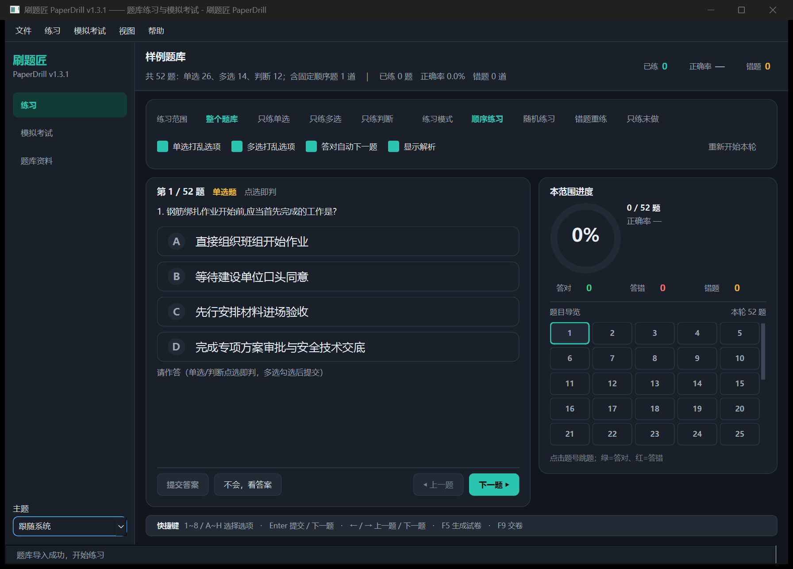

# 11 - 练习位置记忆与练习页布局改造（v1.3.1）

| 项 | 内容 |
|---|---|
| 版本 | v1.3.1 |
| 关联需求 | 用户 2026-10-17 反馈的四项：<br>① 练习模式更改后改回来不能延续之前进度<br>② 「本范围进度」添加类似的题目导览<br>③ 提交答案等按钮与题目板块合并<br>④ 快捷键放在最下面为一长条 |
| 影响模块 | 领域/控制器：`practice.py`、`store.py`、`ui/controller.py`、`gui.py`（仅模式/范围切换）<br>界面：`ui/widgets.py`、`ui/pages/practice.py`、`ui/main_window.py` |
| 兼容性 | 进度文件 `schema` 仍为 2，仅新增 `session.positions` 字段；旧文件可直接读；tkinter / Qt 两套界面共用同一份进度与配置 |
| 不做 | 不改题库原文件；不改 PaperForge；不新增第三方依赖；不改随机模式的洗牌算法 |

---

## 一、需求 ①：练习位置按（模式, 范围）分别记忆

### 1.1 现象

在「顺序练习」停在第 50 题，切到「随机练习」看几题，再切回「顺序练习」——位置回到第 1 题。
「错题重练」「只练未做」以及「整个题库 / 只练单选 / 只练多选 / 只练判断」的范围切换同样会丢位置。
已作答记录、正确率、错题本都不丢，丢的只是「当前停在哪一道题」。

### 1.2 根因

切换模式/范围时界面调用 `PracticeSession.rebuild()`，它会重建队列并把 `cursor` 归零；
随后 `save_position()` 又把进度文件里**唯一的** `session` 记录覆盖成新队列的 `pos=0`。
也就是说：旧位置在新状态落盘前就已经被丢弃，切回来时无从恢复。

### 1.3 设计

**位置按 `（练习模式, 练习范围）` 组合键分别记忆，切换时先存旧位置、再恢复目标位置。**

1. `PracticeSession.position_key()` 生成组合键，例如 `order:all`、`random:single`、
   `wrong:multiple`、`fresh:judge`（整个题库后缀为 `all`）。
2. `save_position()` 把当前组合键的位置条目写入进度文件：

   ```json
   "session": {
     "mode": "order", "last_fp": "…", "pos_fps": ["…", "…"], "pos": 49,
     "positions": {
       "order:all":    { "last_fp": "…", "pos_fps": ["…"], "pos": 49, "ts": "…" },
       "random:all":   { "last_fp": "…", "pos_fps": ["…"], "pos": 12, "ts": "…" },
       "order:single": { "last_fp": "…", "pos_fps": ["…"], "pos": 2,  "ts": "…" }
     }
   }
   ```

   顶层 `mode / last_fp / pos_fps / pos` 仍按旧格式写当前状态，供旧版本与旧测试读取；
   组合键位置表是**增量字段**，最多 4 模式 × 4 范围 = 16 项。
3. `restore_position()`：取当前组合键对应的条目恢复，
   **指纹窗口优先**（当前题 + 其后最多 3 题，见 `docs/07`），全部未命中才用 `pos` 夹取兜底，
   且兜底返回 `False`（不谎报「已精确恢复」）；没有该条目时退回顶层旧格式，行为与旧版一致。
4. 控制器 `set_mode()` / `set_scope()` 的时序：

   ```
   保存旧组合键位置 → rebuild(目标队列) → 非空则 restore_position(adopt_mode=False)
   → 保存新组合键位置 → 重置作答反馈
   ```

   空队列（例如错题本为空时的「错题重练」）仍走 `_apply_empty_state()`，不会因恢复位置抛异常。
   tkinter 回退界面的 `_set_mode()` / `_set_scope()` 做同样的小修，两套界面行为一致。

### 1.4 取舍

* 随机模式切回来仍会**重新洗牌**（没有保存整条随机队列），但会按题目指纹停在**同一道题**；
* 「重新开始本轮」仍表示从头开始，会把当前组合键的位置写回第 1 题；
* 位置表是脏数据容错的：`positions` 不是 dict、条目不是 dict、`pos` 非法、空队列保存都不会抛异常。

---

## 二、需求 ②：「本范围进度」中的题目导览

### 2.1 组件

`ui/widgets.py` 新增 `QuestionNavigator`：

* 5 列方格（`COLUMNS=5`），格高 34px、间距 4px，按「题号 1..N」居中显示；
* 固定约 5 行高（194px），题目更多时在**内部滚动**，不撑高侧栏；当前题变化时自动滚入视口；
* 点击格子发出 `go_requested(队列下标)`，练习页转成 `goto_requested` 信号，
  主窗口接到 `controller.goto()`；
* 格子 `Qt.NoFocus`，点过题号后 `Enter / ← / → / 1~8` 快捷键仍由主窗口处理。

### 2.2 状态与配色

状态取「本轮队列中该题最近一次作答记录」：

| 状态 | 判定 | 浅色表现 |
|---|---|---|
| 答对 | `record.done and record.last == "right"` | `success_weak` 底 + `success` 字/描边 |
| 答错 | `record.done and record.last == "wrong"` | `danger_weak` 底 + `danger` 字/描边 |
| 未答 | 其余 | `surface` 底 + `border` 描边 + `text_muted` 字 |
| 当前题 | `session.cursor` | 2px `primary` 描边 + 加粗（未答时 `surface_alt` 浅灰底，接近参考截图） |

性能：只在题量变化时重建按钮；样式按 `(主题, 状态, 是否当前)` 签名缓存，
300+ 题翻页/作答时只更新变化过的格子；无题目时隐藏导览网格，只保留「题目导览 / 暂无题目」。

### 2.3 与进度环的口径

* 「本范围进度」的环与「已练 / 总数」按**当前范围**统计（沿用 `scope_stats()`）；
* 题目导览显示的是**本轮队列**（顺序模式的全部范围题目；随机模式是洗牌后的队列；
  错题重练 / 只练未做是过滤后的队列），与「上一题 / 下一题」完全一致。

---

## 三、需求 ③：作答按钮并入题卡

原布局右侧栏是一张独立的「提交答案 / 不会，看答案 / 上一题 / 下一题」卡片；
现在四个按钮移到**题卡内部最底部**：

```
题卡：题号/题型/状态 → 题干 → 选项 → 反馈 → 解析 → （拉伸） → 分隔线 → 按钮行
按钮行：[提交答案] [不会，看答案] ……………… [◀ 上一题] [下一题 ▶]
```

* 题卡随窗口拉伸时按钮始终贴在题卡底部，不再占用右侧栏；
* 控件属性名 `submit_button / reveal_button / prev_button / next_button` 保持不变，
  既有的禁用逻辑与测试不受影响。

---

## 四、需求 ④：快捷键底栏

* 练习页根布局最后一项新增 `QFrame#ShortcutBar`，横跨整页、高 32px；
* 文案：`1~8 / A~H 选择选项 · Enter 提交 / 下一题 · ← / → 上一题 / 下一题 · F5 生成试卷 · F9 交卷`；
* 左端加粗「快捷键」，右侧文字在窄窗口下被裁剪而不撑宽页面（完整文案在 tooltip 中）；
* 删除右侧栏原来的「快捷键」卡片；`apply_theme()` 同步刷新底栏与导览配色。

---

## 五、验证

| 项 | 命令 / 方式 | 结果 |
|---|---|---|
| Qt 界面 + 新增回归 | `pytest tests\test_qt_controller.py tests\test_position_memory.py tests\test_qt_practice.py tests\test_qt_navigator.py tests\test_qt_shortcuts.py tests\test_qt_theme.py tests\test_qt_exam.py tests\test_qt_dialogs.py -v` | **193 passed** |
| 领域层回归 | `pytest tests\test_paperdrill.py::TestPracticeSession ::TestProgressStore ::TestBuildItem tests\test_review_fixes.py tests\test_import_layouts.py tests\test_word_pdf_import.py -v` | **129 passed** |
| Qt 无头自检测试 | `pytest tests\test_qt_selftest.py -v` | **11 passed**（含完整闭环 `ok=true`） |
| tkinter 模式切换回归 | `pytest tests\test_paperdrill.py::TestRedoAnsweredQuestions -v` | **9 passed** |
| 代码检查 | `ruff check src tools tests` | **All checks passed** |
| Qt 自检 | `python -m paperdrill --qt-selftest --bank fixtures\样例题库.xlsx` | **ok=true，stage=done** |
| 真实题库验收 | 308 题 `（变电土建负责人）题库.xlsx`：第 50 题 → 随机 → 顺序；单选范围往返；错题重练（空）往返；只练未做往返；换控制器重开 | **全部回到原题/原位**；进度文件含 `order:all / random:all / wrong:all / fresh:all / order:single` |
| 外观目检 | 离屏渲染 1180×820 浅色/深色、1024×700 最小尺寸、空态、第 50 题跳转；真实窗口 `PrintWindow` 实拍（深色、150% DPI） | 导览 5 列、当前格高亮、内部滚动、按钮在题卡底部、底栏通栏均正常 |

新增测试文件：

* `tests/test_position_memory.py`（14 项）：组合键、模式往返、范围往返、模拟重启、空错题模式、旧格式兼容、脏数据、空队列、`save_session(positions)` 往返与保留语义；
* `tests/test_qt_navigator.py`（19 项）：5 列网格、NoFocus、点击下标、四态配色、主题切换、同题量不重建、300 题、练习页状态映射、主窗口点击跳题。

真实窗口（Windows 平台插件、深色主题、150% DPI）实拍：



---

## 六、兼容与风险

* 进度文件 `schema=2` 不变；`session.positions` 为新增可选字段，旧版本读到会忽略，
  旧文件没有该字段时按原来的顶层 `last_fp / pos_fps / pos` 恢复；
* 题库删减、题库改名/换目录继承、考试交卷后重建练习队列等既有逻辑不变，
  它们仍通过 `save_position()` 落盘，因而自动带上组合键位置表；
* tkinter 回退界面只改 `_set_mode/_set_scope`，未改其视觉布局（按既有设计，tkinter 功能冻结）；
* 随机模式的位置恢复只保证「同一道题」，不保证与关闭前相同的随机队列顺序（与 `docs/07` 一致）。
